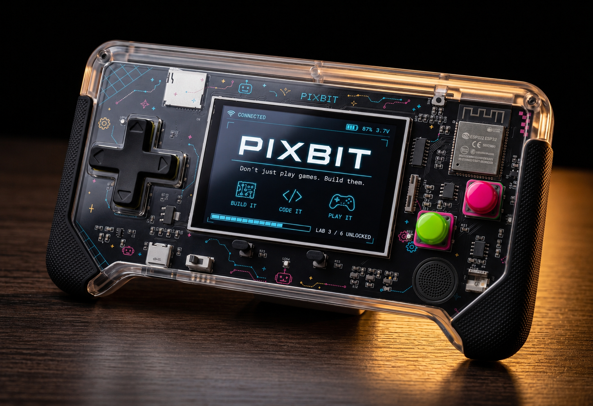
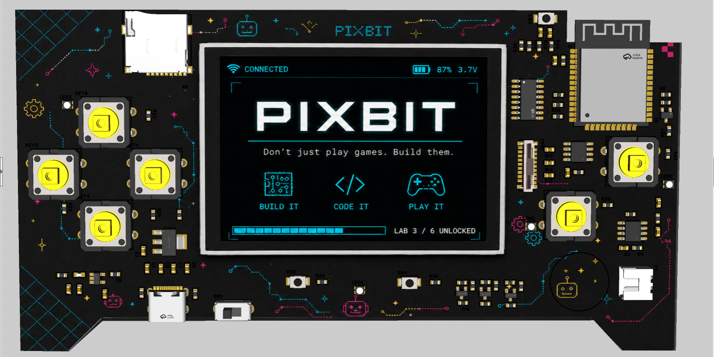
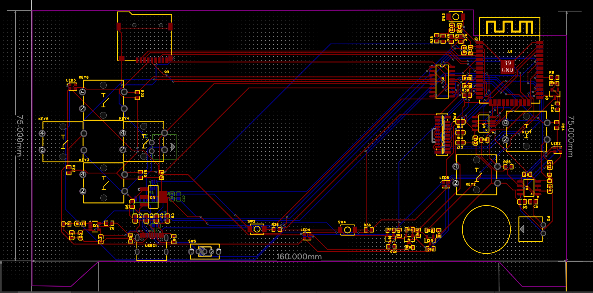

<div align="center">

# PIXBIT

### Don't just play games. Build them.

**An open-source ESP32 handheld game console made for learning: solder it, code it, play it, then build your own games, robots and gadgets on the same hardware.**




</div>

---

## Why PIXBIT

Students usually learn coding, electronics and PCB design in separate classes and never see how they fit together. PIXBIT puts all of it in one device people actually want to use: a game console. You learn embedded programming by writing games, electronics by reading the board you're holding, and hardware design by modifying the open schematic.

**Built for** students, makers, educators, robotics clubs and anyone who wants their first real embedded project to be fun.

## Hardware (v1)

<table>
<tr>
<td width="50%"><br/><sub>PCB 3D render</sub></td>
<td width="50%"><br/><sub>Layout: 160 × 75 mm, 2 layers</sub></td>
</tr>
</table>

- **ESP32 module** with Wi-Fi + Bluetooth, for multiplayer and wireless projects
- **Color display** via FPC connector
- **D-pad + 2 action buttons**, plus 2 menu buttons
- **USB-C** for charging and programming
- **Battery-powered** with a power switch
- **microSD slot** for games and assets
- **Speaker** for audio
- **Expansion connector** for sensors and modules
- Status LEDs and a reset button

Full schematic: [`HARDWARE/pixbit-schematic-v1.pdf`](HARDWARE/pixbit-schematic-v1.pdf)

## Repository layout

```text
HARDWARE/   Schematic and hardware notes
FIRMWARE/   Firmware (in progress)
images/     Renders used in this README
```

## Roadmap

- [x] Schematic v1
- [x] PCB layout v1
- [ ] Gerbers + BOM for ordering
- [ ] Bring-up firmware: display, buttons, audio, SD card
- [ ] Starter game library + "write your first game" tutorial
- [ ] Lesson plans for classrooms

## Get involved

PIXBIT is developed in the open. Ideas, firmware, games and lesson plans are all welcome:

- ⭐ **Star the repo** to follow progress
- 💡 [Open an issue](https://github.com/Prateek-elec/PIXBIT/issues) with a feature idea or a game you'd build
- 🔧 Send a pull request

## License

[MIT](LICENSE) © Prateek Sarkar
